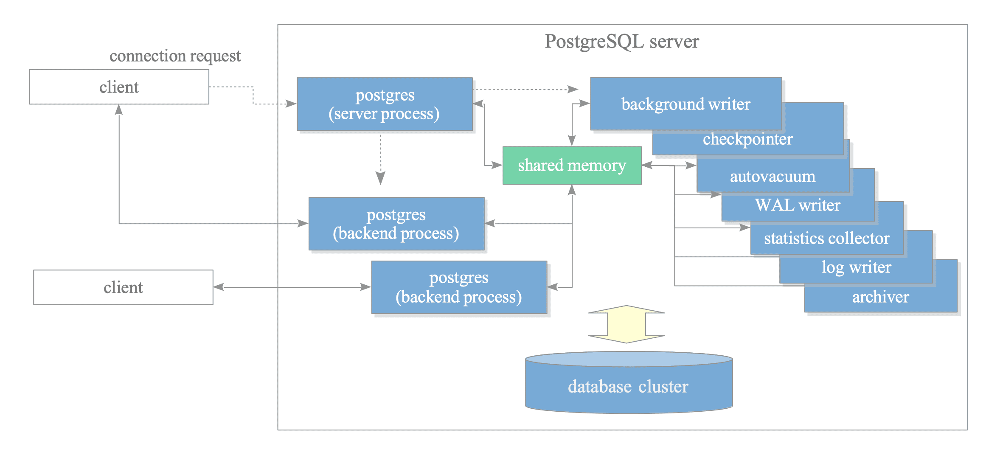
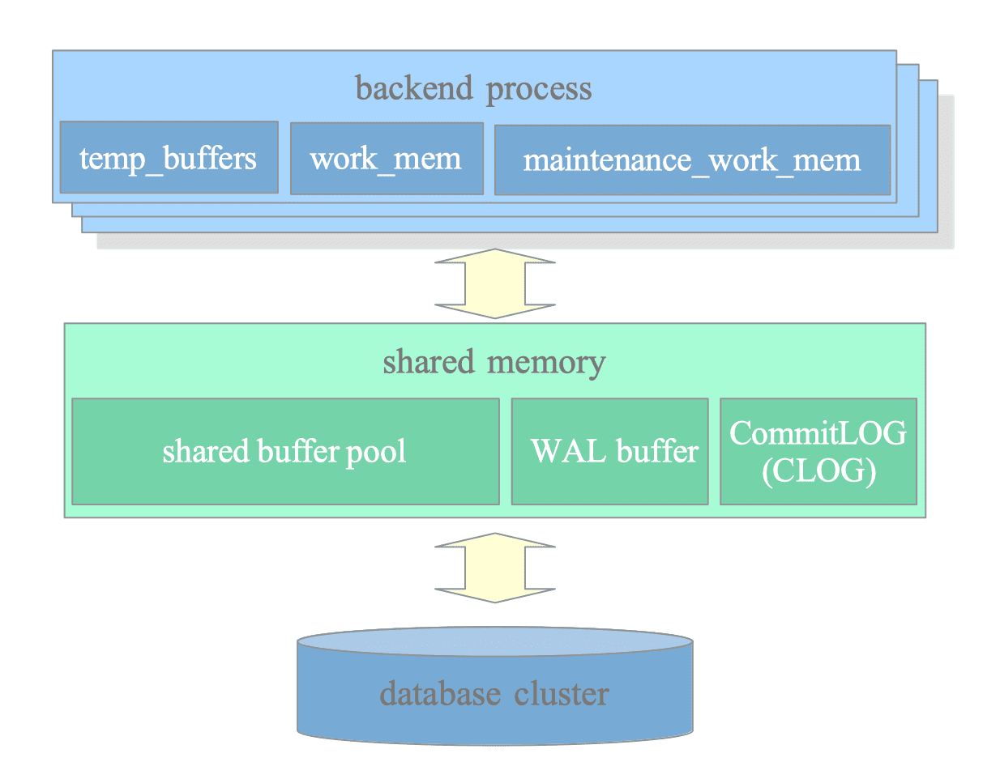

## 1 进程架构

### 1.1 进程分类

PostgreSQL 是多进程架构，其进程分为以下 4 类：
1. **主进程（Postgres server process）**：负责生出其他进程。
2. **后端进程（Backend processes）**：每当一个客户端连接建立，就会生出一个后端进程，负责处理该连接的所有查询。
3. **后台进程（Background processes）**：负责处理一些特定任务的进程，如 `VACCUM`、`CHECKPOINT` 等。
4. **复制相关进程（Replication-associated processes）**：流复制（Streaming Replication，也可叫做物理复制）和逻辑复制（Logical Replication）相关的进程。
5. **后台工作进程（Background worker processes）**：用户自定义的工作进程，详情可查看[官方文档](https://www.postgresql.org/docs/current/bgworker.html)

下图展示了一个包含前 3 类进程的 PostgreSQL 实例（后续小节我们也将会对这 3 类进程进行详细说明）：  


> **为什么 PostgreSQL 采用多进程而不是多线程架构？**
> 
> PostgreSQL 开发始于 1990 年代，那个时候多线程技术还不稳定，多进程技术成熟稳定且有以下 2 个特别大的好处：
> - **良好的故障隔离性（Robust Isolation）**：由于每个连接对应一个单独的后端进程，如果这个后端进程崩溃，不会像多线程程序那样因为共享同一个进程地址空间而直接把整个服务进程一起带崩。
> - **操作系统级内存管理(OS-Level Memory Management)**：由于每个后端进程都有单独的内存空间，相比多线程，这样更容易保证数据的一致性，而且内存管理工作（分配、回收等）不需要自己负责，而是由成熟的操作系统负责。
>
> 近年来，关于是否应该改用多线程架构以消除多进程架构的进程创建的开销的争论一直不断，然而将庞大的遗留代码库重构为线程安全的成本和风险是巨大的，此外，现代操作系统的进步已经显著降低了这种开销，因此，PostgreSQL 继续沿用其高度可靠的多进程架构。
{: .prompt-info }

### 1.2 主进程（Postgres Server Process）

主进程是所有其他进程的父进程，是在 PostgreSQL 启动时的第一个进程，在早期的版本中，这个进程叫做 `postmaster`。

启动时，它会分配一个共享内存区域，启动各种后台进程，根据需要启动复制相关进程和后台工作进程。然后监听 5432 端口（默认，可修改），等待客户端连接，当有连接请求时，主进程会生出一个后端进程来专门负责处理这个连接。

### 1.3 后端进程（Backend processes）

一个后端进程是用来专门处理一个客户端连接的，PostgreSQL 支持多个客户端同时连接，最大数量由 [max_connections](https://www.postgresql.org/docs/current/runtime-config-connection.html#GUC-MAX-CONNECTIONS) 参数控制。连接使用 TCP 协议，当客户端断开连接后，对应的后端进程也会被销毁。

每个后端进程只能操作一个数据库，因此，客户端连接时必须指定要连接的数据库。

由于 PostgreSQL 没有连接池功能（复用连接），如果客户端应用需要频繁的建立连接然后断开连接，服务端会频繁的生出和销毁进程，会造成服务点负载过大而影响性能。但是可以使用第三方的连接池中间件来解决该问题，比如 [pgbouncer](https://www.pgbouncer.org/) 和 [pgpool-II](https://www.pgpool.net/)。

### 1.4 后台进程（Background Processes）

根据处理的任务类型不同，有着不同类型的后台进程，具体如下表：

| 进程 | 描述 |
| --- | ---- |
| background writer | 后台写入进程，周期性的把缓冲区的脏页写入磁盘。 |
| checkpointer | 检查点进程，负责保存数据库恢复所需的信息。 | 
| autovacuum launcher | 负责周期性的启动自动清理工作进程（autovacuum-worker process）来进行 VACCUM 和 ANALYZE 操作。 |
| WAL writer | WAL 写入进程，周期性的把 WAL 缓冲区的数据写入磁盘。 |
| WAL summarizer | 负责追踪数据库块的更改，并把这些更改写入总结文件，用于支持增量备份。（PG17 引入） |
| statistics collector | 统计信息收集进程，负责收集系统状态信息供 pg_stat_activity 和 pg_stat_database 等系统视图使用。 |
| logging collector | 日志写入进程，负责把日志写入文件。 |
| io worker | 负责处理异步读取操作。（PG18 引入） |
| archiver | WAL 日志归档进程。 |

以下是一个 PostgreSQL 实例的进程树示例：
```shell
$ pstree -p 6541
-+= 00001 root /sbin/launchd
 \-+= 06541 postgres /usr/local/pgsql/bin/postgres -D data
   |--= 06542 postgres postgres: io worker 0
   |--= 06543 postgres postgres: io worker 1
   |--= 06544 postgres postgres: io worker 2
   |--= 06545 postgres postgres: checkpointer
   |--= 06546 postgres postgres: background writer
   |--= 06548 postgres postgres: walwriter
   |--= 06549 postgres postgres: autovacuum launcher
   |--= 06550 postgres postgres: walsummarizer
   |--= 06551 postgres postgres: logical replication launcher
   |--= 08412 postgres postgres: postgres testdb [local] idle
   \--= 08482 postgres postgres: postgres testdb [local] idle in transaction
```

## 2 内存架构

### 2.1 内存分类

PostgreSQL 中的内存区域主要分为 2 类：
- **本地内存（Local memory）**：后端进程自己分配并自己使用的内存区域。
- **共享内存（Shared memory）**：所有进程共用的内存区域。



### 2.2 本地内存

每个后端进程会自己分配一个本地内存区域供自己用来处理客户端查询使用，该区域又细分为多个子区域，主要的子区域如下表：

| 子区域 | 用途 |
| ----- | --- |
| work_mem | 用于 `ORDER BY` 和 `DISTINCT` 的排序操作，以及 `merge-join` 和 `hash-join` 的联合操作。 |
| maintenance_work_mem | 用于各种维护性操作，如 `VACCUM` 和 `REINDEX`，以及索引创建等。 |
| temp_buffers | 用于存储临时表。 |

### 2.3 共享内存

PostgreSQL 启动时会分配一个共享内存区域，这个区域也细分为多个子区域，主要的子区域如下表：

| 子区域 | 用途 |
| ----- | --- |
| shared buffer pool | PostgreSQL 把表和索引数据页从磁盘中读取到该区域后进行操作。 |
| WAL buffer | 保存 WAL 日志的区域，然后由 WAL writer 周期性的把该区域数据写入磁盘。 |
| commit log | 保存提交日志（CLOG）的区域，提交日志是反应所有事务状态的日志，用于并发访问控制。 |

## 3 参考资料

[Process and Memory Architecture] : https://www.interdb.jp/pg/pgsql02/index.html
